# MpeiApp

<p align="center">
  <strong>БАРС, расписание, карта и виджеты — в кармане студента МЭИ.</strong><br />
  Неофициальное бесплатное приложение для Android и iOS.
</p>

<p align="center">
  <a href="https://play.google.com/store/apps/details?id=com.mpeiapp"></a>
  <a href="https://apps.apple.com/ru/app/mpeiapp/id1618910681"></a>
  <a href="docs/v2.6.0-release.md"></a>
  <a href="LICENSE"></a>
</p>

<p align="center">
  <a href="package.json"></a>
  <a href="package.json"></a>
  <a href="package.json">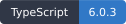</a>
  <a href=".nvmrc"></a>
</p>

<p align="center">
  <a href="https://github.com/TheKeeroll/MpeiApp-Public/actions/workflows/ci.yml"></a>
  <a href="#проверки-и-доставка"></a>
  <a href="#проверки-и-доставка"></a>
  <a href="#проверки-и-доставка"></a>
</p>

<p align="center">
  <br />
  <sub>Промо-арт</sub>
</p>

<p align="center">
  
  
  
  
  
  
  
</p>

<p align="center">
  <a href="#ключевые-особенности">Возможности</a> ·
  <a href="#скриншоты">Скриншоты</a> ·
  <a href="#технологический-стек">Стек</a> ·
  <a href="#архитектура">Архитектура</a> ·
  <a href="#проверки-и-доставка">Проверки</a>
</p>

## Последний релиз

**MpeiApp 2.6.0 опубликован 11.11.2026 в Google Play и App Store.**
Выпуск включает восстановление и развитие виджетов, работу с обязательными
анкетами БАРС, обновлённую рекламу и DragoNet, раздельные настройки
персонализации/геолокации и проверку обновлений магазинов.
Сборка Xcode Cloud, внешнее TestFlight-тестирование и платформенная приёмка
завершены. Подробности — в [итогах релиза](docs/v2.6.0-release.md).

## Ключевые особенности

| Возможность | Что умеет приложение |
| --- | --- |
| **БАРС** | Оценки с деталями КМ и анализом дисциплин, пропуски с автоматическим подсчётом, зачётная книжка, стипендии, задания, книги, приказы и анкеты. |
| **Вход** | Авторизация с двухфакторной аутентификацией и восстановлением сессии; отдельный сценарий при блокировке БАРС обязательными анкетами. |
| **Расписание** | Своя и любая другая группа, преподаватель или аудитория; поиск доступен и без входа. |
| **Виджеты** | Две недели расписания, выбор даты и возврат на сегодня без запуска приложения. Интерактивный iOS-виджет требует iOS 17+. |
| **3D-карта** | Места МЭИ и окрестностей, фильтры категорий, маршруты к выбранному месту или пользовательской точке. На Android — с 8.0. |
| **QR-сканер** | Авторегистрация на занятиях и других мероприятиях, где МЭИ использует QR-коды присутствия. |
| **Сводки и офлайн** | Счётчики активных стипендий и непрочитанных писем ОСЭП, локальный кеш учебных данных для доступа без сети. |
| **Оформление** | Темы, семь иконок приложения, рамки QR-сканера и токены лояльности. |
| **Обновления** | Проверка Google Play / App Store после загрузки основного интерфейса, актуальный список изменений и переход в магазин. |

## Скриншоты

Экран второго фактора | Страница оценок | Выбор раздела БАРС | Пропуски занятий
--- | --- | --- | ---
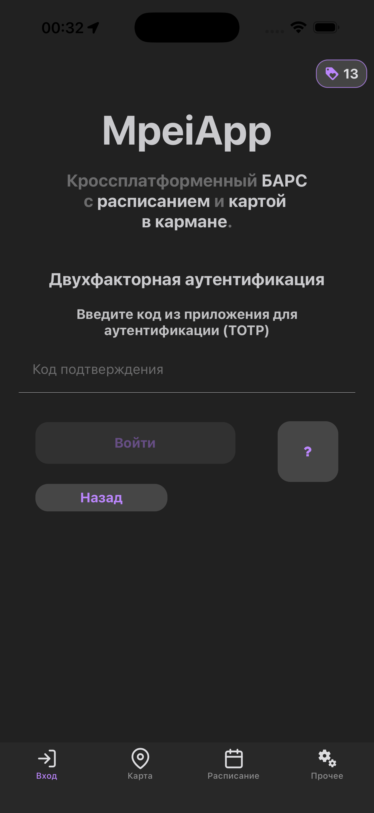 | 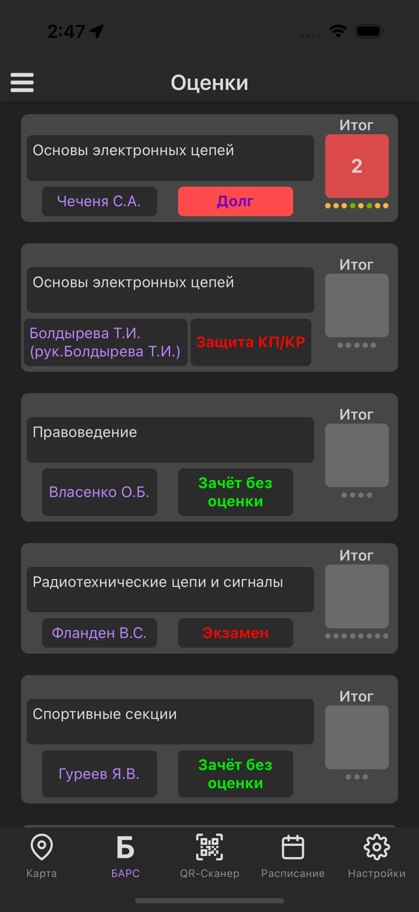 | 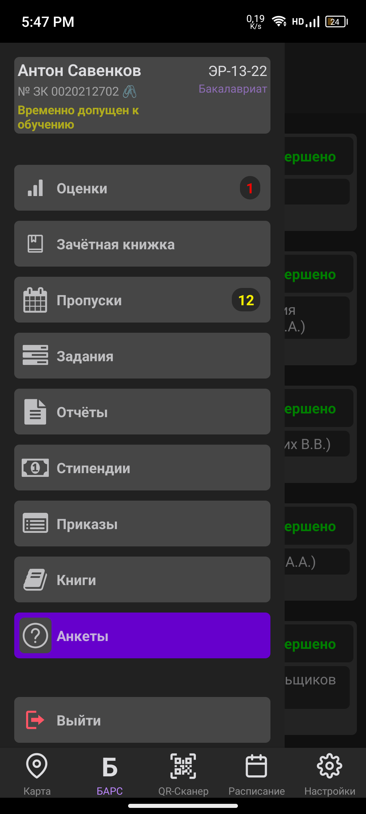 | 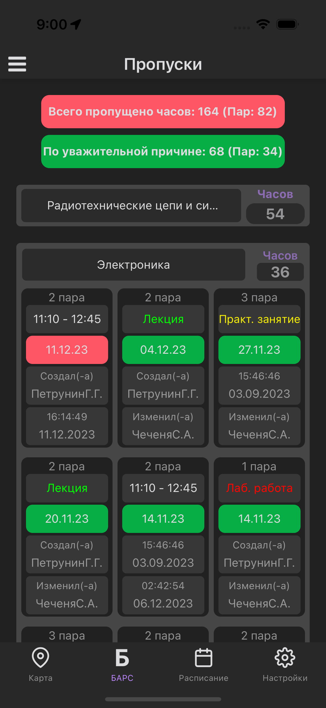

Карта — общий вид | Выбор маршрута | Категории на карте | Зачётная книжка
--- | --- | --- | ---
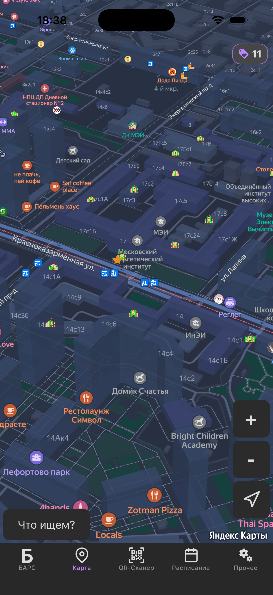 | 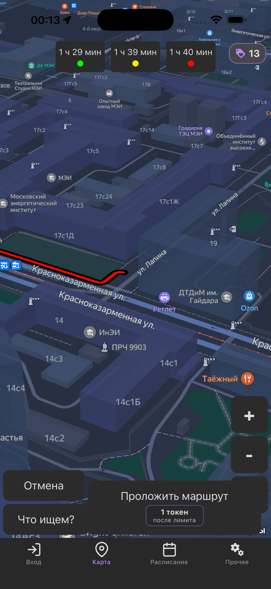 | 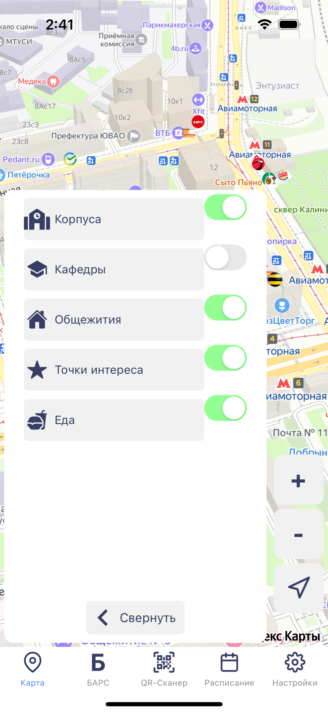 | 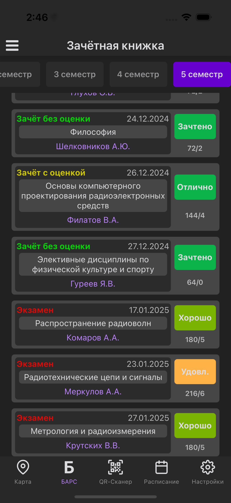

Расписание | Расписание аудитории | QR-сканер: авторегистрация | Стипендии
--- | --- | --- | ---
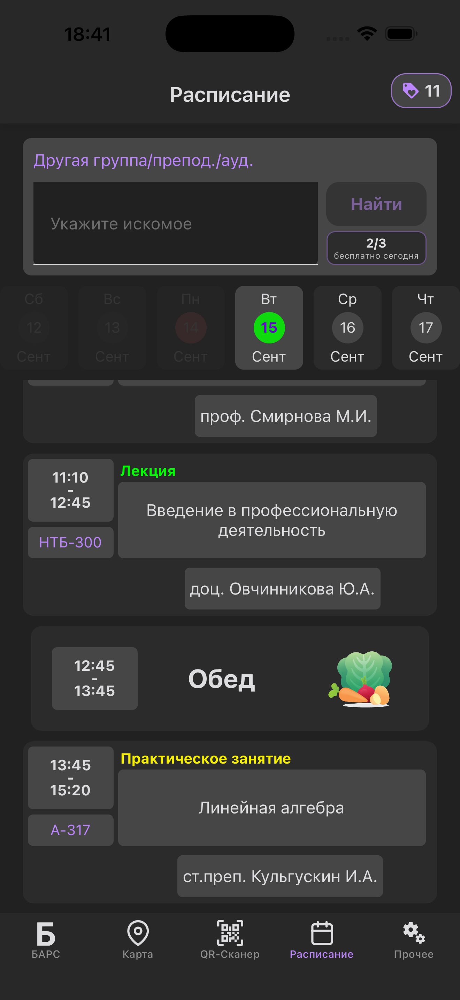 | 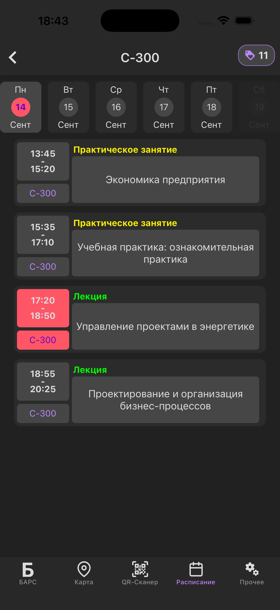 | 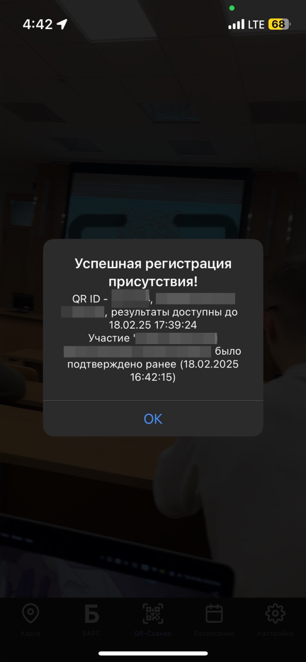 | 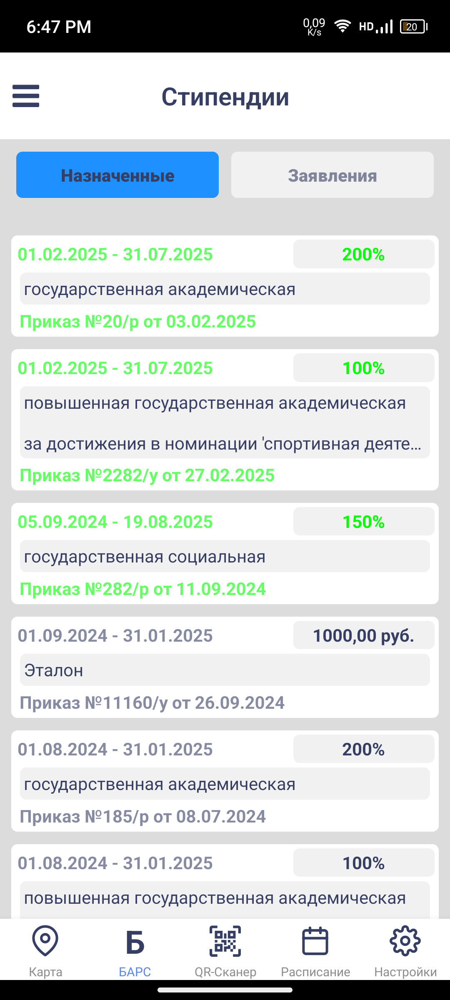

## Реклама и DragoNet

MpeiApp остаётся бесплатным. Реклама и интеграция с DragoNet помогают покрывать расходы на разработку и инфраструктуру, чтобы приложение можно было и дальше поддерживать, выпуская обновления и сохраняя доступным в магазинах. Активная подписка DragoNet отключает рекламу в приложении и открывает связанные с ней преимущества.

Согласия на персонализацию и передачу геолокации разделены, доступны для изменения в «Прочее» и учитываются рекламными запросами. Подтверждение совершеннолетия обязательно для включения персонализации; доступ к геолокации дополнительно зависит от разрешения ОС. Токены лояльности используются для оформления, дополнительных возможностей и локального отключения рекламы.

## Технологический стек

| Область | Технологии и назначение |
| --- | --- |
| **Клиент** | TypeScript 6.0.3, React 19.3.1, React Native 0.88.1; общий код Android и iOS. |
| **Интерфейс** | React Native Paper, React Navigation 7, Reanimated, Gesture Handler, Safe Area Context, Lottie и Vector Icons. |
| **Состояние и хранение** | Redux Toolkit для учебных данных и статусов разделов; MMKV для локального кеша и настроек. |
| **Разбор данных** | Отдельные HTML/JSON-парсеры, в том числе node-html-parser; явные состояния авторизации, загрузки и ошибок. |
| **Нативные возможности** | Яндекс Карты через react-native-yamap, Vision Camera для QR, геолокация и смена иконок. |
| **Виджеты** | Android: Java, AppWidgetProvider и RemoteViews. iOS: Swift, WidgetKit, App Intents и общий App Group. |
| **Реклама** | Yandex Mobile Ads 8.6.0; медиация BIGO Ads и VK Реклама; inline, sticky и rewarded. |
| **DragoNet proxy** | Node.js 24, TypeScript, Fastify, Zod, SQLite / better-sqlite3; HTTPS и systemd на VPS. |
| **Инструменты** | Yarn Classic и lockfiles, Metro, patch-package; Gradle для Android, CocoaPods / Xcode для iOS. |

Версии зависимостей и команды: [клиент](package.json), [proxy](vpn-subscription-proxy/package.json).

## Архитектура

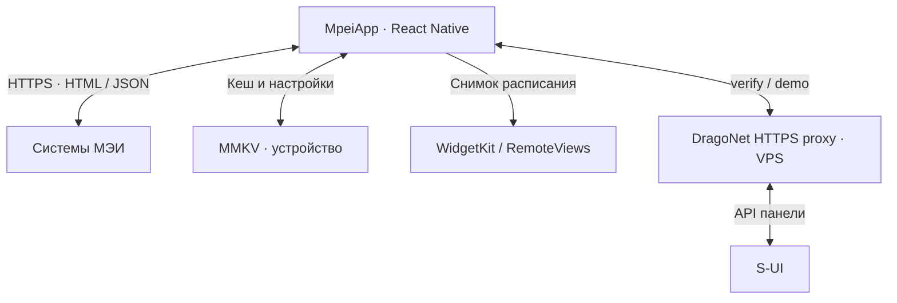

**БАРС и загрузка данных.** [Слой API](src/API) управляет авторизацией и сессией, разбирает ответы систем МЭИ [отдельными парсерами](src/API/Parsers) и передаёт результат в Redux. Минимально необходимые данные загружаются прежде второстепенных разделов; [сервис прогресса](src/Loading) показывает этапы, а разделы поддерживают собственный повтор загрузки. Отмена запросов и проверка поколения сессии защищают состояние от запоздалых ответов после выхода или смены аккаунта. Блокировка обязательными анкетами обрабатывается отдельно от неверного пароля, без потери успешной авторизации.

**Состояние и офлайн.** [Экраны](src/Screens) используют Redux-состояния загрузки, успеха, ошибки и офлайн-данных. MMKV хранит кеш, настройки, согласия и локальные данные лояльности. За счёт этого доступ к сохранённым учебным данным не зависит от доступности сети при каждом открытии раздела.

**Нативные виджеты.** [Общий слой сериализации и синхронизации](src/Widgets) формирует снимок расписания на две недели. На iOS bridge публикует его в App Group и обновляет WidgetKit timeline; на Android — в нативное хранилище для RemoteViews. Московская полночь, смена недели, возврат из фона и выход из аккаунта учитываются при синхронизации. Нативное представление и интерактивные кнопки реализованы отдельно для каждой платформы.

**Реклама и привилегии.** Модули [Ads](src/Ads), [Loyalty](src/Loyalty) и [Vpn](src/Vpn) разделяют рекламные размещения, локальные покупки и эффективный статус подписки. Загрузка рекламы учитывает видимость экрана, положение баннера и фон приложения; rewarded готовится при видимости блока или явном действии пользователя. Изменение согласий сбрасывает старые рекламные сессии. Временные привилегии DragoNet сохраняют реальный локальный баланс и покупки, а технический сбой проверки не приравнивается к немедленному отзыву подписки.

**Граница DragoNet proxy.** Мобильный клиент получает результат verify/demo от [отдельного сервиса](vpn-subscription-proxy), а тот обращается к S-UI. Token панели, TLS-ключи и HMAC-ключ cooldown остаются на VPS. SQLite хранит HMAC-идентификаторы для ограничения повторной выдачи demo; reservation сохраняется при неопределённом ответе панели, чтобы повтор запроса не создал второй пробный доступ. Запуск проверяет DNS и TLS-материал, а journal помогает разбирать отказы без записи персональных ссылок и серверных секретов.

**Сопровождение интеграций.** [patch-package-патчи](patches) сохраняют необходимые исправления нативных библиотек, включая lifecycle баннеров, взаимодействие карты с React Native и смену Android-иконок. Поведение внешних HTML-страниц проверяется на fixtures, а разбор обновлений магазинов изолирован от университетской сессии и не блокирует запуск приложения.

## Проверки и доставка

Клиент проверен **562 тестами Jest в 50 наборах**. Для proxy и модели iOS-виджета зафиксированная база релиза 2.6.0 — **93 теста** и **13 Swift-тестов** соответственно. Чип CI ведёт к результатам workflow ветки `dev`.

| Уровень | Что проверяется |
| --- | --- |
| **TypeScript / Jest** | Парсеры и обезличенные fixtures, вход/2FA/анкеты, состояния загрузки, расписания, интерфейс, видимость рекламы, согласия и проверка обновлений. |
| **Proxy / Node test runner** | HTTP-контракт, валидация, ошибки upstream, rate limit, SQLite / cooldown, TLS discovery и сценарии установщика с изолированными зависимостями. |
| **Нативные модели** | Swift Package для календаря/данных iOS-виджета; отдельный быстрый JVM-тест календаря, размеров и страниц Android-виджета. |
| **GitHub Actions** | Четыре основные jobs: mobile quality, Metro smoke, Android debug APK и proxy quality. Фильтры путей исключают ненужные прогоны; push тега включает все проверки. |
| **Xcode Cloud** | Установка по lockfiles, генерация клиентской конфигурации из Secret variables, Release Archive, общий build number app/widget и доставка в TestFlight / App Store Connect. |

Основные команды:

```bash
yarn typecheck
yarn test:ci
npm --prefix vpn-subscription-proxy run typecheck
npm --prefix vpn-subscription-proxy test
node scripts/test-android-widget.cjs
# На macOS:
swift test --package-path ios/ScheduleWidgetCore
```

Тесты с подменёнными native SDK и transport дополняются сборками и проверкой на устройствах. Перед выпуском 2.6.0 подтверждены Android-поведение, новая Cloud-сборка, внешнее TestFlight-тестирование и работа приложения, персонализации и iOS-виджета.

Подробности сопровождения: [CI](docs/v2.6.0-stage-7-ci.md), [Xcode Cloud](ios/ci_scripts/README.md), [медиация](docs/ads-mediation.md), [установка proxy](vpn-subscription-proxy/README.md) и [обновление VPS](vpn-subscription-proxy/UPDATING.md).

## Disclaimer

**MpeiApp — неофициальное приложение; официальных приложений МЭИ не существует.**

Разработчик ранее обучался в МЭИ, но сейчас никак с вузом не связан. Поэтому он может, но не обязан отвечать на вопросы о МЭИ, которые не относятся к приложению!

Мы не можем гарантировать бесперебойную работу или абсолютную безопасность приложения и не несём ответственности за проблемы, связанные с его использованием. Приложение предоставляется **as is**.

## Обратная связь

Если вы столкнулись с проблемой при использовании MpeiApp, хотите предложить улучшение или помочь проекту:

- [Сообщество ВКонтакте](https://vk.ru/mpeiapp)
- [Личный Telegram разработчика (DragonSavA)](https://t.me/DragonSavA)
